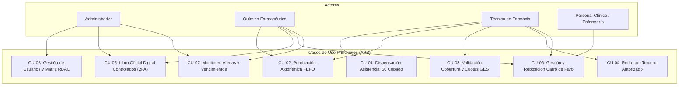
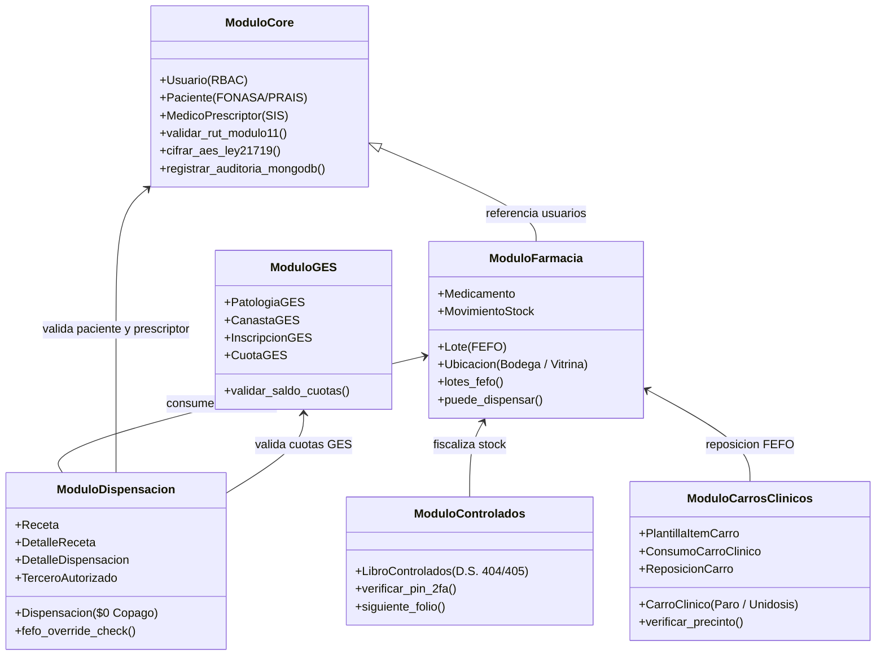
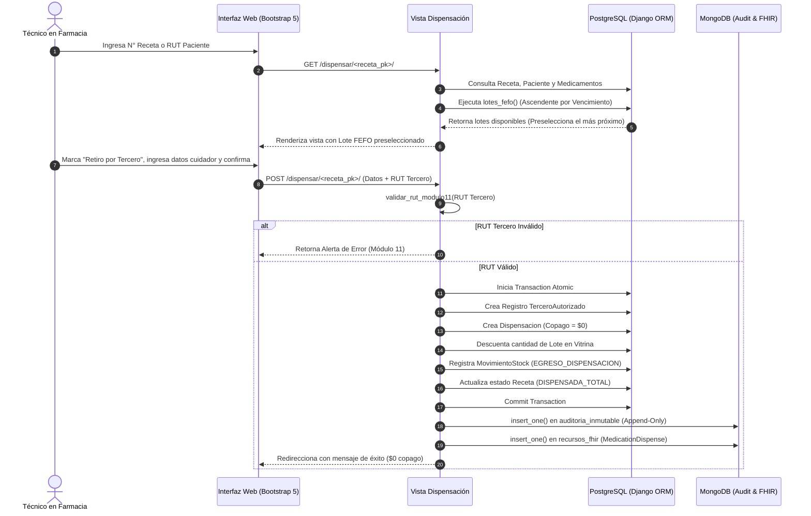
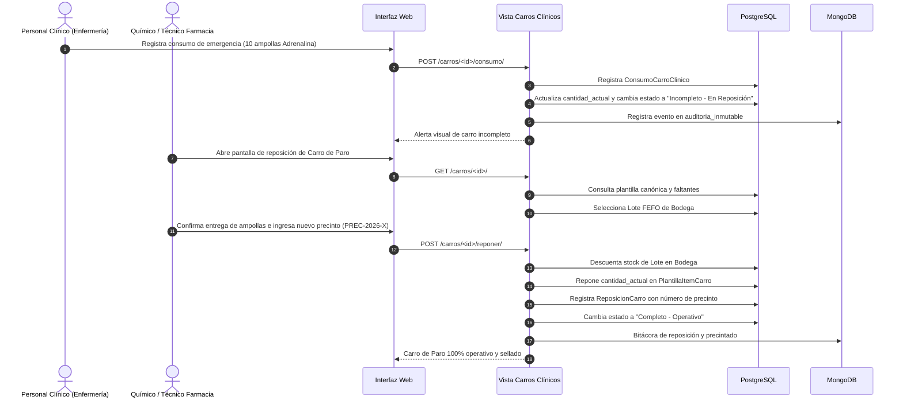
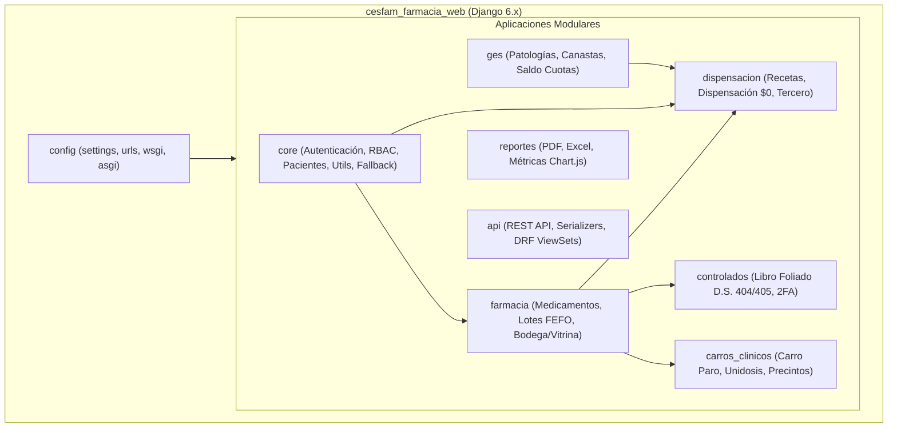
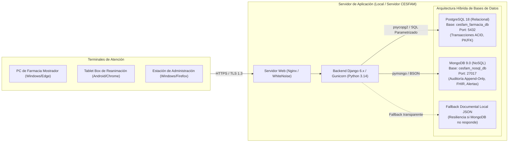

# Diagramas de Arquitectura y Modelo Entidad-Relación (MER)
## Sistema Web de Gestión y Simulación Asistencial para Farmacia CESFAM
**Autores:** Egon Muñoz Muttel, Renato Suazo Burgos  
**Asignatura:** Proyecto Integrado - INACAP 2026  
**Profesor Guía:** Juan Mir Castillo  

---

## 1. Diagrama Entidad-Relación (MER) - Base de Datos PostgreSQL

```mermaid
erDiagram
    USUARIO {
        int id PK
        string username
        string password
        string rut UK
        string first_name
        string last_name
        string email
        string rol "admin, quimico, tecnico, clinico"
        string totp_secret
        string pin_seguridad
        boolean activo_sistema
        datetime fecha_creacion
    }

    PACIENTE {
        int id PK
        string rut UK
        string nombres
        string apellido_paterno
        string apellido_materno
        date fecha_nacimiento
        string sexo
        string prevision "fonasa_a, fonasa_b, fonasa_c, fonasa_d, prais"
        boolean cronico
        boolean activo
    }

    MEDICO_PRESCRIPTOR {
        int id PK
        string rut UK
        string nombres
        string apellido_paterno
        string apellido_materno
        string especialidad
        string registro_sis UK
        boolean habilitado
    }

    CATEGORIA_MEDICAMENTO {
        int id PK
        string nombre UK
        string descripcion
        boolean es_controlado
    }

    MEDICAMENTO {
        int id PK
        string codigo UK
        string nombre_generico
        string nombre_comercial
        string concentracion
        string forma_farmaceutica
        string unidad_medida
        int categoria_id FK
        int stock_minimo
        int stock_maximo
        boolean requiere_receta
        boolean es_controlado
        boolean activo
    }

    UBICACION {
        int id PK
        string nombre
        string tipo "bodega, vitrina"
        string descripcion
        boolean activa
    }

    LOTE {
        int id PK
        int medicamento_id FK
        string numero_lote
        date fecha_fabricacion
        date fecha_vencimiento
        int cantidad_inicial
        int cantidad_actual
        int ubicacion_id FK
        string proveedor
        boolean activo
    }

    MOVIMIENTO_STOCK {
        int id PK
        int lote_id FK
        string tipo
        int cantidad
        int cantidad_anterior
        int cantidad_posterior
        string motivo
        int usuario_id FK
        int ubicacion_origen_id FK
        int ubicacion_destino_id FK
        datetime fecha
    }

    RECETA {
        int id PK
        string numero_receta UK
        int paciente_id FK
        int medico_id FK
        string tipo "simple, retenida, cheque, cronica"
        string estado "pendiente, parcial, total, anulada, vencida"
        string diagnostico
        date fecha_emision
        date fecha_vencimiento
        string observaciones
    }

    DETALLE_RECETA {
        int id PK
        int receta_id FK
        int medicamento_id FK
        int cantidad_prescrita
        int cantidad_dispensada
        string posologia
        int dias_tratamiento
    }

    TERCERO_AUTORIZADO {
        int id PK
        string rut
        string nombres
        string apellido_paterno
        string apellido_materno
        string parentesco
        string telefono
    }

    DISPENSACION {
        int id PK
        int receta_id FK
        int usuario_dispensador_id FK
        boolean retiro_tercero
        int tercero_autorizado_id FK
        decimal copago
        string observaciones
        datetime fecha
    }

    DETALLE_DISPENSACION {
        int id PK
        int dispensacion_id FK
        int detalle_receta_id FK
        int lote_id FK
        int cantidad
        boolean fefo_override
        string justificacion_override
    }

    PATOLOGIA_GES {
        int id PK
        string codigo UK
        string nombre
        string descripcion
        boolean activa
    }

    CANASTA_GES {
        int id PK
        int patologia_id FK
        int medicamento_id FK
        int cantidad_por_cuota
        int cuotas_autorizadas
    }

    INSCRIPCION_GES {
        int id PK
        int paciente_id FK
        int patologia_id FK
        date fecha_inscripcion
        date fecha_inicio_periodo
        date fecha_fin_periodo
        boolean activa
    }

    CUOTA_GES {
        int id PK
        int inscripcion_id FK
        int canasta_id FK
        int numero_cuota
        int cantidad_entregada
        int dispensacion_id FK
        datetime fecha_entrega
    }

    LIBRO_CONTROLADOS {
        int id PK
        int folio UK
        int medicamento_id FK
        int lote_id FK
        string tipo_movimiento
        int cantidad
        int saldo_anterior
        int saldo_posterior
        int receta_id FK
        int paciente_id FK
        int quimico_responsable_id FK
        boolean verificacion_2fa
        string observaciones
        datetime fecha_registro
    }

    CARRO_CLINICO {
        int id PK
        string nombre
        string tipo "paro, unidosis"
        string ubicacion_fisica
        string estado "completo, incompleto, en_uso, mantenimiento"
        string numero_precinto
        datetime fecha_ultimo_precinto
        int responsable_actual_id FK
        boolean activo
    }

    PLANTILLA_ITEM_CARRO {
        int id PK
        int carro_id FK
        int medicamento_id FK
        int cantidad_requerida
        int cantidad_actual
        string ubicacion_en_carro
    }

    CONSUMO_CARRO_CLINICO {
        int id PK
        int carro_id FK
        int item_id FK
        int cantidad_consumida
        string motivo
        string paciente_atendido
        int personal_clinico_id FK
        datetime fecha
    }

    REPOSICION_CARRO {
        int id PK
        int carro_id FK
        int item_id FK
        int lote_id FK
        int cantidad_repuesta
        int usuario_farmacia_id FK
        string nuevo_precinto
        datetime fecha
    }

    %% Relaciones Principales
    CATEGORIA_MEDICAMENTO ||--o{ MEDICAMENTO : clasifica
    MEDICAMENTO ||--o{ LOTE : contiene
    UBICACION ||--o{ LOTE : almacena
    LOTE ||--o{ MOVIMIENTO_STOCK : registra
    USUARIO ||--o{ MOVIMIENTO_STOCK : ejecuta

    PACIENTE ||--o{ RECETA : posee
    MEDICO_PRESCRIPTOR ||--o{ RECETA : prescribe
    RECETA ||--|{ DETALLE_RECETA : compone
    MEDICAMENTO ||--o{ DETALLE_RECETA : indicado_en

    RECETA ||--o{ DISPENSACION : origina
    USUARIO ||--o{ DISPENSACION : dispensa
    TERCERO_AUTORIZADO ||--o{ DISPENSACION : retira_por
    DISPENSACION ||--|{ DETALLE_DISPENSACION : contiene
    DETALLE_RECETA ||--o{ DETALLE_DISPENSACION : satisface
    LOTE ||--o{ DETALLE_DISPENSACION : entrega

    PATOLOGIA_GES ||--|{ CANASTA_GES : define
    MEDICAMENTO ||--o{ CANASTA_GES : integra
    PACIENTE ||--o{ INSCRIPCION_GES : adscrito_a
    PATOLOGIA_GES ||--o{ INSCRIPCION_GES : vincula
    INSCRIPCION_GES ||--o{ CUOTA_GES : computa
    CANASTA_GES ||--o{ CUOTA_GES : descuenta
    DISPENSACION ||--o{ CUOTA_GES : asocia

    MEDICAMENTO ||--o{ LIBRO_CONTROLADOS : fiscaliza
    LOTE ||--o{ LIBRO_CONTROLADOS : audita
    USUARIO ||--o{ LIBRO_CONTROLADOS : firma
    RECETA ||--o{ LIBRO_CONTROLADOS : justifica

    CARRO_CLINICO ||--|{ PLANTILLA_ITEM_CARRO : conforma
    MEDICAMENTO ||--o{ PLANTILLA_ITEM_CARRO : estandariza
    PLANTILLA_ITEM_CARRO ||--o{ CONSUMO_CARRO_CLINICO : consume
    CARRO_CLINICO ||--o{ CONSUMO_CARRO_CLINICO : registra_en
    USUARIO ||--o{ CONSUMO_CARRO_CLINICO : reporta
    PLANTILLA_ITEM_CARRO ||--o{ REPOSICION_CARRO : repone
    LOTE ||--o{ REPOSICION_CARRO : abastece
    USUARIO ||--o{ REPOSICION_CARRO : autoriza
```

---

## 2. Modelo Arquitectural 4+1 de Kruchten

### 2.1 Vista de Casos de Uso (Escenarios)

---

### 2.2 Vista Lógica (Estructura de Componentes de Dominio)

---

### 2.3 Vista de Procesos

#### 2.3.1 Secuencia: Dispensación Asistencial con Lógica FEFO y Tercero Autorizado

#### 2.3.2 Secuencia: Emergencia en Carro de Paro y Reposición FEFO

---

### 2.4 Vista de Desarrollo (Estructura de Módulos Django)

---

### 2.5 Vista Física / Despliegue (Arquitectura Híbrida)

